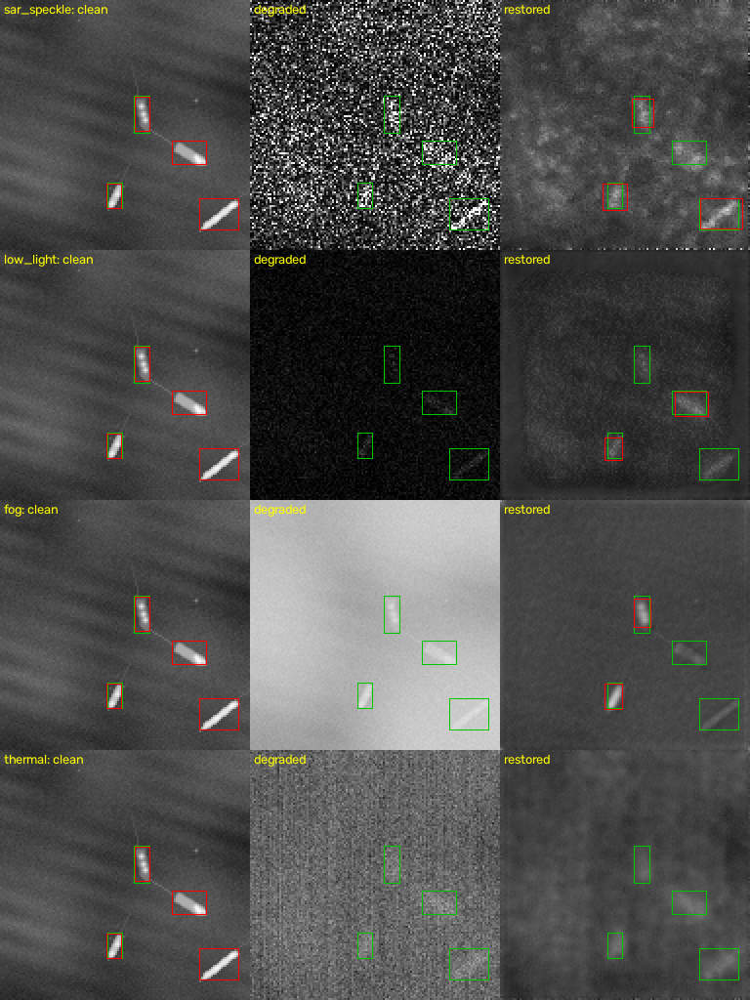
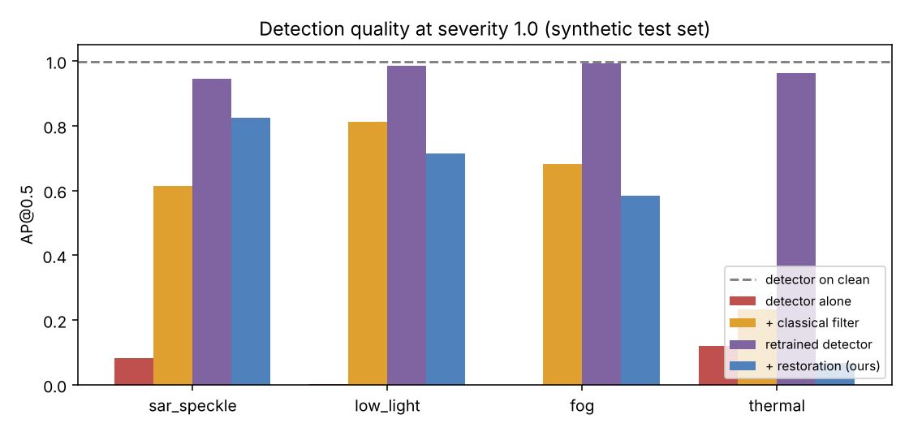
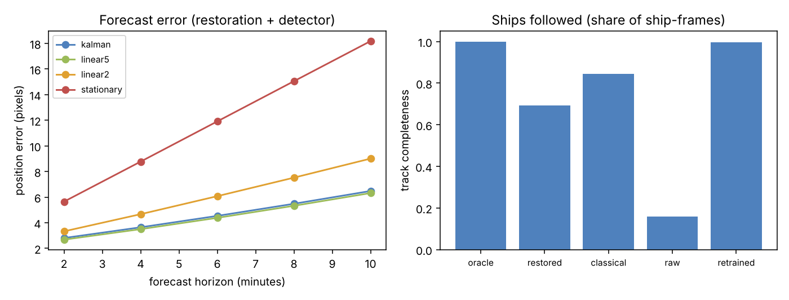

# Vision

> An AI **pre-processing layer** for degraded ISR imagery (SAR speckle, low light, fog,
> low-quality thermal). It sits *in front of* an existing detector and restores the signal
> instead of asking the customer to retrain their model.

This repository is a **proof of concept** built to answer one question quickly:

> *Does a small restoration network make a detector that collapses on degraded imagery usable
> again, and does it beat the obvious alternatives?*
>
> Short answer on synthetic data: usable again, yes; better than the alternatives, no (not yet).

It is a complete, MLOps-style project: data simulator, training, ONNX export, a quality gate,
a Dockerised API, tests, and GitHub Actions pipelines (CI, retraining, release).

**Read this first (honest status).**

- The numbers below come from a **synthetic** maritime scene generator, not from real
  sensors. They show that the *pipeline and the method work*; they do **not** prove
  performance on real SAR / thermal data. See [Data](#data) and [Limitations](#limitations).
- On this benchmark the restoration layer **helps a frozen detector a lot, but does not beat
  simply retraining the detector with augmentation**, and a classical filter is competitive.
  The details are in [Results](#results).
- The pipeline is ready for real data (YOLO-format loader + a Pascal-VOC converter for
  SSDD-style datasets), but real datasets could not be downloaded from the sandbox this
  project was built in. Running on a real dataset is the obvious next step.

---

## Table of contents

1. [How it works](#how-it-works)
2. [Data](#data)
3. [Results](#results)
4. [Tracking and 10-minute forecast](#tracking-and-10-minute-forecast)
5. [Quick start](#quick-start)
6. [API and dashboard](#api-and-dashboard)
7. [Docker](#docker)
8. [MLOps: tests and CI/CD](#mlops-tests-and-cicd)
9. [Project layout](#project-layout)
10. [Using real data](#using-real-data)
11. [Limitations and next steps](#limitations-and-next-steps)

---

## How it works

```
 degraded frame ──► RestorationNet (U-Net, ~114k params) ──► restored frame ──► detector
   (SAR / IR /        learns the *correction*                       (the customer's own
    fog / dark)       degraded + correction = restored               detector, or ours)
```

Three building blocks:

| Block | File | What it does |
|---|---|---|
| Degradation simulator | `degradations.py` | Physics-inspired models: gamma-distributed **speckle** (SAR), **shot + read noise** and gain loss (low light), **Koschmieder** scattering `I = J·t + A·(1−t)` (fog), blur + low resolution + fixed-pattern noise (thermal). One `severity` knob; values above the training range test generalisation. |
| Synthetic scenes | `synthetic.py` | Procedural sea, land, distractors (buoys, rocks, wave crests) and ships with **free ground-truth boxes**. Unlimited labelled data, including hard cases. |
| Models | `models.py` | `RestorationNet`: small residual U-Net. `DetectorNet`: small CenterNet-style detector. Both are fully convolutional (any image size) and have fewer than 150k parameters, so they train on a laptop CPU and run in milliseconds. |

The **training recipe** matters as much as the models:

1. The detector is trained on **clean images only**. It stands in for "the customer's existing
   model", which was never trained on degraded data.
2. The restoration network is trained to map `degrade(clean) → clean` (L1 loss) over random
   degradation kinds and severities (0.3 – 1.0).
3. Both are exported to **ONNX**. The serving path (`inference.py`, `api.py`) never imports
   PyTorch, so the Docker image stays small and the edge story is realistic.

### Baselines (so the claim is falsifiable)

Every result is compared with:

- **Detector alone** on the degraded image (the problem statement).
- **Classical filter** (`classical.py`): 3×3 median + percentile contrast stretch, untuned and
  identical for every degradation kind, exactly like the blind learned restorer. This is what an
  engineer would write in an afternoon without ML.
- **Retrained detector** (`train_detector.py --augmented`): the same detector trained directly
  on degraded data. This answers the key product question: *is a restoration layer better than
  just retraining the detector with augmentation?*

## Data

| Source | Status | Notes |
|---|---|---|
| **Synthetic maritime scenes** (default) | Works out of the box, no download | Generated on the fly, deterministic given a seed. Train and test seeds are disjoint. |
| **YOLO-format folder** | Supported (`data.source: yolo`) | Any dataset converted to `images/<split>` + `labels/<split>`. |
| **SSDD / SAR-Ship / LS-SSDD** (Pascal VOC) | Converter provided: `scripts/voc_to_yolo.py` | Not downloaded here (see below). |

Real datasets worth trying: **SSDD** and **HRSID** (SAR ship detection), **ExDark** (low-light
object detection), **FLIR ADAS** (thermal). Hugging Face, Zenodo and Google Drive were not
reachable from the build environment, which is why the reported numbers are synthetic. Download
them on your machine and follow [Using real data](#using-real-data).

## Results

Benchmark: 200 fixed test images (seed 1000, never seen in training), AP at IoU 0.5, 128×128
grayscale, CPU. Severity 1.3 is **outside** the training range (0.3 – 1.0).

<!-- RESULTS:START -->
AP@0.5 for each way of handling a degraded image (higher is better):

Clean images (no degradation): AP@0.5 = **0.999** (clean-trained detector), **0.994** (augmentation-trained detector)

| Degradation | Severity | Detector alone | + classical filter | + restoration (ours) | Retrained detector (augmentation) | PSNR before → after |
|---|---|---|---|---|---|---|
| sar_speckle | 0.5 | 0.517 | 0.899 | 0.930 | 0.986 | 16.9 → 28.0 dB |
| sar_speckle | 1.0 | 0.083 | 0.614 | 0.825 | 0.944 | 13.2 → 25.3 dB |
| sar_speckle | 1.3 (unseen) | 0.035 | 0.398 | 0.678 | 0.859 | 12.2 → 24.3 dB |
| low_light | 0.5 | 0.740 | 0.975 | 0.968 | 1.000 | 18.6 → 25.8 dB |
| low_light | 1.0 | 0.002 | 0.811 | 0.713 | 0.986 | 13.5 → 20.9 dB |
| low_light | 1.3 (unseen) | 0.000 | 0.516 | 0.063 | 0.870 | 12.9 → 18.4 dB |
| fog | 0.5 | 0.114 | 0.961 | 0.972 | 0.994 | 8.4 → 24.0 dB |
| fog | 1.0 | 0.000 | 0.682 | 0.585 | 0.993 | 6.0 → 22.2 dB |
| fog | 1.3 (unseen) | 0.000 | 0.459 | 0.174 | 0.994 | 5.4 → 21.5 dB |
| thermal | 0.5 | 0.545 | 0.679 | 0.744 | 0.995 | 18.5 → 28.2 dB |
| thermal | 1.0 | 0.120 | 0.232 | 0.067 | 0.962 | 15.8 → 25.9 dB |
| thermal | 1.3 (unseen) | 0.029 | 0.067 | 0.009 | 0.840 | 14.8 → 24.3 dB |

Averages over the four degradation kinds:

| Severity | Detector alone | + classical filter | + restoration (ours) | Retrained detector |
|---|---|---|---|---|
| 0.5 | 0.479 | 0.878 | 0.903 | 0.994 |
| 1.0 | 0.051 | 0.585 | 0.548 | 0.971 |
| 1.3 (unseen) | 0.016 | 0.360 | 0.231 | 0.891 |




### What these results say (read before drawing conclusions)

1. **The problem is real.** A detector trained on clean images collapses on degraded ones
   (mean AP 0.05 at severity 1.0, while it scores 0.999 on clean images).
2. **The restoration layer helps a frozen detector**: mean AP goes from 0.05 to 0.55 at severity
   1.0, with about +11 dB PSNR. It is clearly useful on SAR speckle (0.08 → 0.83) and at mild
   severities.
3. **But it is not yet a convincing product on this benchmark.**
   - An **untuned classical filter** (median + contrast stretch) matches or beats the learned
     restorer on low light, fog and thermal at severity 1.0 and above, and is far better on
     unseen severities.
   - **Simply retraining the detector with degradation augmentation beats the restoration layer
     everywhere** (mean AP 0.97 at severity 1.0).
   - **PSNR is not AP.** On thermal at severity 1.0 the restored image gains about 10 dB yet
     detection gets *worse* (0.120 → 0.067): the network produces smooth, plausible images that
     erase the small targets the detector needs.
4. **So the honest positioning is narrower than the initial pitch.** A restoration layer is only
   worth selling where the customer's detector **cannot be retrained** (closed, certified or
   frozen model; no access to their data). When retraining is possible, it should win. The current
   learned restorer also still has to beat a decent classical baseline before it justifies its
   complexity.

Caveats: synthetic and simple scenes, tiny networks (about 100k parameters), a single seed, and
the same simulator is used for training and testing (only the severity extrapolation is out of
distribution). Treat the ordering of methods as a hypothesis to test on real data, not a finding.
<!-- RESULTS:END -->

## Tracking and 10-minute forecast

A second layer sits on top of the detector. It answers the operational question: *"a sharp photo
is taken every hour; in between, a degraded frame arrives every 2 minutes. Where are the ships,
and where will each one be in the next 10 minutes?"*

```
 t = 0 min      sharp reference photo ──► detector ─────────┐
 t = 2, 4, ...  degraded frame ──► restoration ──► detector ┼──► tracker (Kalman) ──► forecast +2 ... +10 min
                                                            │        keeps ship identities,        with a 95 %
                                                            │        coasts through missed          uncertainty
                                                            ┘        detections                     ellipse
```

| Module | What it does |
|---|---|
| `trajectories.py` | Simulates ship motion: roughly constant speed, steering jitter and **maneuvers** (turns), so a straight-line forecast cannot look perfect by construction. |
| `scenario.py` | Builds a full sequence: static sea, buoys (static false alarms), moving ships, the sharp photo at t=0 and a degraded frame every 2 minutes, with exact ground truth. |
| `tracking.py` | Multi-ship **Kalman filter** (state: x, y, vx, vy), Mahalanobis-gated association, track confirmation / deletion, and the forecast with its covariance (numpy only). |
| `sequence.py` | Glue: detect every frame (with restoration, with a classical filter, or alone), run the tracker, produce JSON-ready snapshots. |
| `evaluate_tracking.py` | Benchmark and CI gate for the whole chain. |

The sharp photo gives the tracker reliable starting positions; the degraded frames then update
them. A track is confirmed after two sightings (this removes isolated false alarms), keeps
"coasting" on the motion model for up to four missed frames, and is deleted after that. The
process noise of the filter was tuned on separate validation scenarios (seeds disjoint from the
benchmark; SAR speckle, near-perfect detections), and the 95 % ellipse is checked for calibration
rather than assumed.

### Tracking results

40 simulated scenarios (10 per degradation kind, severity 1.0, 16 frames each, 2 minutes apart),
every ship-frame scored against the exact ground truth. Errors are in pixels at +10 minutes
(ships move 0.8 to 2.5 pixels per minute). All rows use the **same tracker**; only the
source of the detections changes.

| Detections from | Ship recall | False alarms / frame | Track completeness | ID switches / ship | Forecast availability | Kalman error | Linear (5 pts) error | Linear (2 pts) error | Stationary error | 95 % ellipse coverage |
|---|---|---|---|---|---|---|---|---|---|---|
| oracle detections (upper bound) | 1.00 | 0.00 | 1.00 | 0.04 | 1.00 | 5.5 | 6.4 | 14.7 | 16.0 | 0.96 |
| restoration + detector (ours) | 0.49 | 0.13 | 0.69 | 0.04 | 0.73 | 6.5 | 6.3 | 9.0 | 18.2 | 0.97 |
| classical filter + detector | 0.62 | 1.81 | 0.85 | 0.06 | 0.86 | 5.9 | 5.9 | 10.8 | 18.2 | 0.96 |
| detector alone | 0.02 | 0.00 | 0.16 | 0.03 | 0.23 | 17.1 | 17.2 | 17.2 | 19.3 | 1.00 |
| retrained detector (augmentation) | 0.97 | 0.29 | 1.00 | 0.01 | 1.00 | 3.8 | 3.3 | 6.4 | 16.9 | 0.96 |



How to read it:

1. **The forecast works when the detections are good.** With near-perfect detections ("oracle"),
   the Kalman forecast at +10 minutes is off by 5.5 px, against 16 px if the ship is assumed not
   to move. The 95 % ellipse contains the true position 96 % of the time, so the uncertainty
   display is honest.
2. **Tracking breaks without enhancement.** The detector alone follows the ships in only 16 % of
   the ship-frames (it loses them after the sharp photo), so no forecast exists for most of them.
   With restoration this becomes 69 %. This is the case for the restoration layer in a tracking
   product: continuity of the track, not only per-image accuracy.
3. **But restoration is not the best option here either.** The classical filter keeps 85 % of the
   ships tracked (at the price of 1.8 false alarms per frame), and a detector retrained with
   augmentation keeps 100 %. Per degradation kind, restoration + detector follows 99 % of the ships
   in SAR speckle, 80 % in low light and fog, but only 16 % in thermal, where the learned
   restorer fails (the same weakness as in the detection benchmark).
4. **Kalman is not clearly better than a simple regression.** A least-squares line through the
   last five detections is as accurate (6.3 px vs 6.5 px with restored detections). The Kalman
   filter's real advantages here are the uncertainty ellipse and the track management
   (confirmation, coasting, identity), not a lower error. A learned trajectory model or a
   turn-aware motion model (constant turn rate) are the natural next experiments.
5. **Everything is simulated**, including the motion model: real vessels (and real AIS-style
   traffic patterns) behave differently.

Reproduce: `make evaluate-tracking` (or `make gate-tracking` to enforce the CI floors).

## Quick start

```bash
python -m venv .venv && source .venv/bin/activate
# CPU-only PyTorch is much smaller than the default wheel
pip install torch --index-url https://download.pytorch.org/whl/cpu
make install        # editable install with the train, serve and dev extras

make test           # 140 tests with coverage
make lint           # ruff check + format check
make pipeline       # train -> export to ONNX -> quality gate
make evaluate       # detection benchmark, writes reports/
make evaluate-tracking  # tracking + forecast benchmark, writes reports/
make viz            # API + dashboard on http://localhost:8000/viz
make serve          # API on http://localhost:8000 (needs the ONNX files in models/)
```

`make help` lists every command. `uv` works too (it reads the same `pyproject.toml`): replace
`pip install ...` by `uv pip install ...`. All hyper-parameters, paths and the CI quality thresholds live
in a single file, `configs/default.yaml`. A run is fully described by *(git commit + that file)*.

## API and dashboard

```bash
make serve
curl -F "file=@sample.png" "http://localhost:8000/detect?restore=true"
curl -F "file=@sample.png" http://localhost:8000/preprocess -o restored.png
```

| Endpoint | Purpose |
|---|---|
| `GET /health` | Readiness probe: `200` when both ONNX models are present, `503` otherwise. |
| `POST /preprocess` | Image in, restored PNG out. **Drop-in layer in front of your own detector.** |
| `POST /detect` | Image in, JSON detections out, with or without restoration (`?restore=`). |
| `GET /viz` | **Interactive dashboard** (see below). `GET /` redirects to it. |
| `GET /sim/scenario` | Simulates a sequence, runs detection + tracking + forecast, returns JSON with the ground truth (`seed`, `kind`, `severity`, `n_frames`, `mode`). |
| `GET /sim/frame/{n}` | One image of that sequence as PNG (`view=input\|processed\|clean`). |
| `POST /track` | **Your own images**: upload an ordered sequence (`files`), with `dt_minutes`, `horizon_minutes`, `mode`; get detections, tracks, velocities and forecasts with 95 % ellipses. |

```bash
# Track ships on your own sequence (first image = sharp reference, then one image every 2 minutes)
curl -F "files=@t00.png" -F "files=@t02.png" -F "files=@t04.png" -F "files=@t06.png" \
     "http://localhost:8000/track?dt_minutes=2&horizon_minutes=10"
```

The dashboard (`/viz`) runs the simulation in the browser: pick the degradation, severity and the
source of the detections (restoration, classical filter or detector alone), then scrub or play
through the frames. It overlays detections, tracks with their trails, the 10-minute forecast with
its 95 % uncertainty ellipses, and, optionally, the **ground truth and the true future path** so
you can see how far each forecast is from what really happened. It is a single HTML file with no
external dependency, so it also works inside the Docker container.

Input hygiene: 10 MB upload limit, 4096×4096 pixel limit, 16-bit PNG/TIFF supported (common for
SAR and thermal sensors). Interactive docs are served at `/docs`.

## Docker

The image is a multi-stage build that installs **only the serving stack** (ONNX Runtime +
FastAPI, no PyTorch), runs as a non-root user, has a health check, and bakes the ONNX models in:
**the image tag is the model version**.

```bash
make docker-build
make docker-run                       # http://localhost:8000
curl http://localhost:8000/health
```

## MLOps: tests and CI/CD

| Workflow | Trigger | What it does |
|---|---|---|
| `ci.yml` | every push to `main`, every PR | **Lint** (ruff) → **tests** on Python 3.10 / 3.11 / 3.12 with coverage → **two model quality gates** (detection, then tracking and forecast) on the committed ONNX files → **Docker build + HTTP smoke test** of the real image. |
| `train.yml` | manual + monthly | Retrains both networks, exports to ONNX, enforces the gate, uploads the models and the report as artefacts. It commits nothing: a human reviews and opens a PR. |
| `release.yml` | git tag `v*` | Builds the image and publishes it to GitHub Container Registry. |

Other safeguards: `dependabot.yml` for dependency updates and a `.pre-commit-config.yaml`
(`pre-commit install`).

**The model quality gates** (`evaluate --gate` and `evaluate_tracking --gate`) are the MLOps piece
worth highlighting. The detection gate fails the build when the restoration layer stops helping: mean AP gain below the floor, mean PSNR gain
below the floor, or latency above budget. The tracking gate fails when too few ships stay
tracked, when the forecast no longer halves the error of "the ship does not move", or when the 95 %
ellipse stops being calibrated (thresholds in `configs/default.yaml`). A model, a
simulator or an inference-code change that regresses cannot be merged.

**Tests** (`tests/`) cover the simulator (ranges, determinism, severity ordering), the metrics
(AP / PSNR / SSIM against hand-computed cases), the post-processing, the models (shapes, any
input size), the data loaders, the scripts, the quality gate logic, and the API over HTTP (including bad
uploads, oversized files and 16-bit images). The ONNX models used by the API tests are exported
on the fly, which also exercises the PyTorch-to-ONNX path. The tracking layer has its own tests: the
Kalman filter (velocity recovery, coasting, gating, identity keeping, and a Monte-Carlo check that
the 95 % ellipse is calibrated), the motion and scene simulators, the benchmark metrics and the new
routes. A test also verifies that the defaults used by the API (which has no YAML file in Docker)
never drift from `configs/default.yaml`.

## Project layout

```
configs/default.yaml     single source of truth for hyper-parameters and CI thresholds
src/isr_restore/
  degradations.py        sensor / weather degradation simulator
  synthetic.py           procedural scenes with ground truth
  classical.py           non-ML baseline
  models.py, data.py     PyTorch networks and datasets            (train extra)
  train_detector.py      detector training (+ --augmented baseline)
  train_restoration.py   restoration training
  export.py              PyTorch -> ONNX with a numerical parity check
  inference.py           ONNX Runtime pipeline: restore -> detect (no PyTorch)
  postprocess.py         decoding of the detector output
  metrics.py             AP@IoU, PSNR, SSIM
  evaluate.py            benchmark, figures, CI quality gate
  trajectories.py        ship motion simulator (speed, steering noise, maneuvers)
  scenario.py            sequences: sharp photo + degraded frames + ground truth
  tracking.py            Kalman multi-ship tracker and forecast with uncertainty
  sequence.py            detection + tracking glue (used by the API and the benchmark)
  evaluate_tracking.py   tracking benchmark and CI gate
  serving.py             pipeline loading and upload validation shared by the routes
  api.py, tracking_api.py  FastAPI service (detection routes / tracking routes)
  static/dashboard.html  the dashboard (plain HTML + JavaScript)
scripts/                 voc_to_yolo.py, make_sample_image.py
tests/                   pytest suite
models/                  committed ONNX models (PyTorch checkpoints are git-ignored)
reports/                 metrics.json, results.md, figures
.github/workflows/       ci.yml, train.yml, release.yml
Dockerfile, Makefile
```

## Using real data

```bash
# 1. Convert a Pascal VOC dataset (e.g. SSDD) to the YOLO layout, all classes merged into "ship"
python scripts/voc_to_yolo.py --images path/to/JPEGImages --annotations path/to/Annotations \
    --out data/real --val-fraction 0.2 --seed 42

# 2. In configs/default.yaml set:  data.source: yolo   (and data.yolo_root: data/real)
# 3. Retrain, export and evaluate
make pipeline && make evaluate
```

With real, already-degraded data, the right protocol is to compare the detector alone, the
detector behind the restoration layer, and the retrained detector on the **same real test split**.
Real SAR imagery is already speckled, so the restoration network should then be trained with
synthetic degradation applied to *clean* optical or despeckled references, or with a
self-supervised objective. Expect to swap the tiny networks for larger backbones.

## Limitations and next steps

- **Synthetic data only.** Gains on real sensors are unproven. This is the first thing to test.
  This includes the ship motion: forecasts were never tested on real vessel tracks.
- **Tracking is image-plane only:** pixels, no georeferencing, no sensor motion compensation, no
  AIS fusion. Convert with the ground sampling distance of your sensor.
- **Constant-velocity forecast.** It is calibrated on turning ships but cannot anticipate a
  turn that has not started yet.
- **Grayscale, single class, 128×128.** Real products need multi-channel, larger frames and several
  classes.
- **The learned restorer does not generalise past its training severities** and loses to a
  classical filter on the hardest low-light, fog and thermal cases (see Results).
- **One blind restorer for all degradations.** It is not told the sensor type. A conditioned or
  per-sensor model, or a physics-based despeckling filter (Lee / Frost) for SAR, may do better.
- **Generalisation is limited beyond the training severities** (see the unseen-severity rows).
- **Latency is measured on a CPU for 128×128 frames**, not on a Jetson with TensorRT.
- Next steps: real datasets, a tuned classical baseline, quantisation and TensorRT benchmarks,
  experiment tracking (MLflow / DVC) and model registry integration.

## License

No license has been chosen yet. Add one before publishing.
